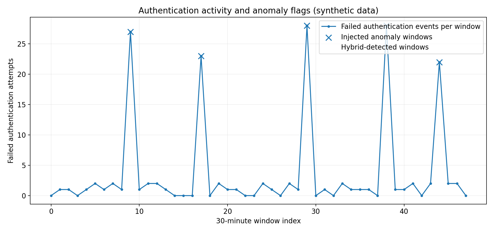
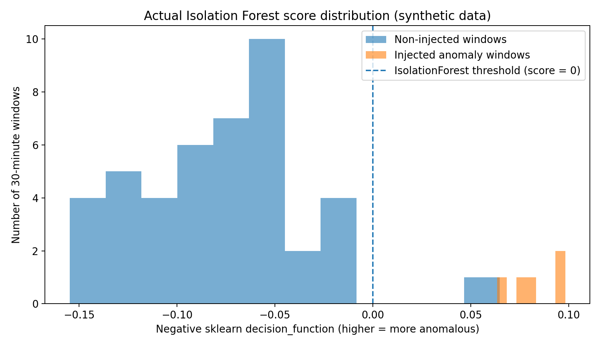
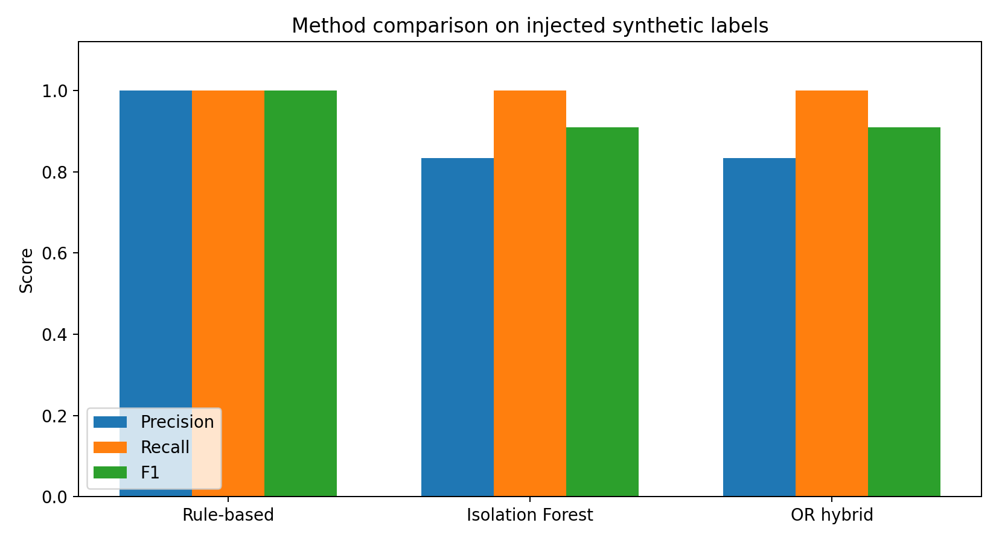
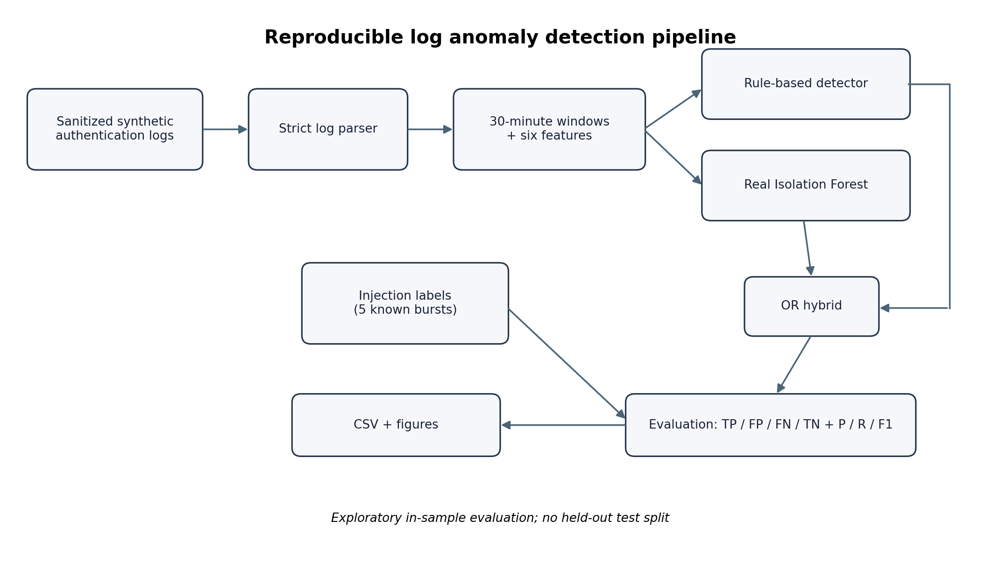
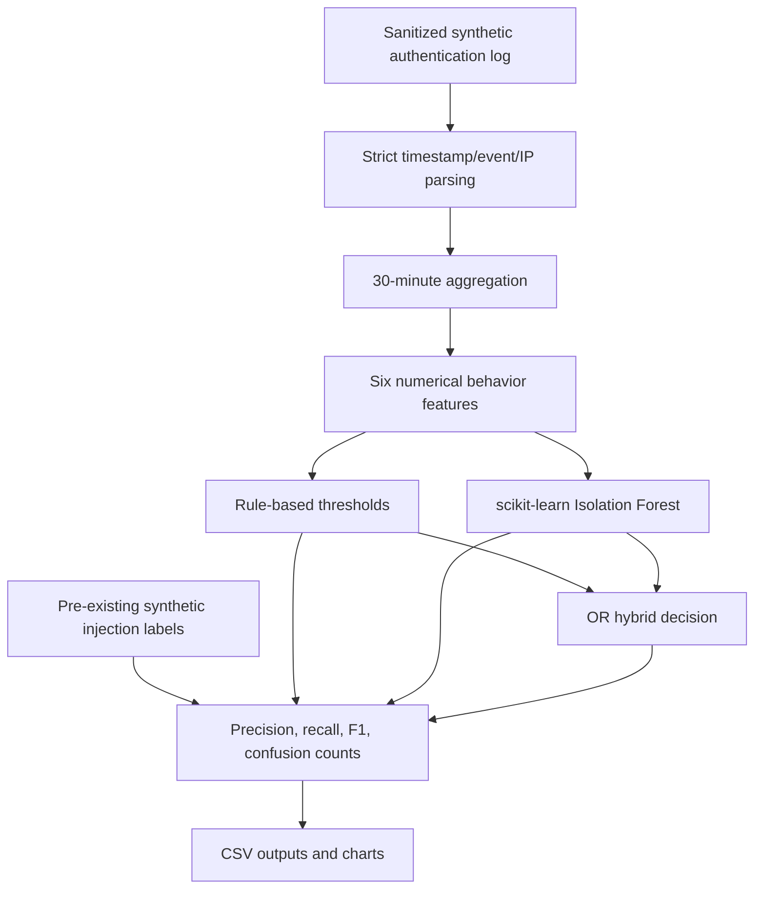

# Log-Based Anomaly Detection | Reproducible Python & QA Portfolio

**Academic-origin portfolio reconstruction | Niko Naseri | November 2026**

A small, inspectable **Python data-processing and anomaly-detection pipeline** for synthetic authentication logs. It turns raw log lines into time-window features, applies **explainable threshold rules** and a **real scikit-learn Isolation Forest**, evaluates predictions against pre-existing simulation labels, and generates charts from the actual program output.

> **Provenance first:** This repository is a **new, tested portfolio reconstruction made after the Master's thesis**, not a verbatim copy of the original thesis code or evidence of professional production deployment. The previously available prototype used a custom standardized-distance score rather than Isolation Forest, and its exported metrics did not match the thesis's Table 2. Those prior results are **not reused** here. See [Provenance & audit](docs/PROVENANCE.md) before quoting any metrics.

## Why this project?

Smaller IT systems may not have enterprise monitoring infrastructure. Structured counts from authentication logs can provide a simple way to identify unusual activity. This prototype asks a limited, testable question: **can an interpretable rule detector and an unsupervised model flag injected failures in a small synthetic dataset?** It is a demonstration, **not** a validated security product.

## Verified results (portfolio rerun)

Running the included code on the included sanitized synthetic dataset, using **scikit-learn 1.8.0** and the documented parameters, produced:

| Detector | TP | FP | FN | TN | Precision | Recall | F1 |
|:--|--:|--:|--:|--:|--:|--:|--:|
| Rule-based thresholds | 5 | 0 | 0 | 43 | 1.000 | 1.000 | 1.000 |
| Real Isolation Forest | 5 | 1 | 0 | 42 | 0.833 | 1.000 | 0.909 |
| OR hybrid | 5 | 1 | 0 | 42 | 0.833 | 1.000 | 0.909 |

- **423** simulated auth events, **48** consecutive **30-minute windows**, **5** pre-labeled injected anomaly windows.
- The OR hybrid **did not outperform either component** on this small sample. The rule-based detector performed best by F1 in this run.
- The IF model was **fit and scored on the same windows**. This is descriptive, in-sample validation against injection labels, **not a held-out generalization estimate**.
- Injection labels represent **generated failed-login bursts**. Off-hours is a feature, not a separately validated injected attack class.
- Results are **sensitive to synthetic-data design and model settings** and must not be extrapolated to production systems.

Raw outputs, including the complete confusion counts, are in [`results/metrics.csv`](results/metrics.csv), [`results/detections.csv`](results/detections.csv) and [`results/run_metadata.json`](results/run_metadata.json).

## Figures derived from the executed experiment







The three experimental charts are generated **programmatically from the current run outputs**, not redrawn or edited to improve apparent performance. The architecture diagram is **schematic** and can be regenerated using `python scripts/generate_architecture.py`.

## Architecture






Feature vector: `success_login_count`, `failed_login_count`, `unique_ip_count`, `event_type_count`, `event_frequency`, and `off_hours`.

**Rules:** a window is flagged if failed logins `>= 12`, or if failed logins `>= 8` and there are `>= 3` distinct source IPs. **Isolation Forest:** 200 estimators, `contamination=0.125`, `random_state=42`. **Hybrid:** logical OR of the two predictions. A higher `iforest_decision_score` represents more anomalous behaviour (`-decision_function`).

## Quick start (Windows PowerShell / Linux / macOS)

**Prerequisite:** Python 3.10+ (the published outputs were verified using Python 3.13.5).

```bash
python -m venv .venv
# Windows PowerShell: .venv\Scripts\Activate.ps1
# Linux/macOS: source .venv/bin/activate
python -m pip install -e ".[dev]"
python -m pytest
python -m logqa run
```

By default `run` reads `data/synthetic/authentication.log` and `data/synthetic/labels.csv` and writes to `results/` and `figures/`.

To direct output to a new location:

```bash
python -m logqa run --output results/independent_run --figures figures/independent_run --seed 42 --contamination 0.125
```

> The `--contamination` setting is a **preselected demonstration parameter** and was not optimized on a held-out validation set. Different package versions can result in small differences; see [reproducibility](docs/REPRODUCIBILITY.md).

## Verification / QA aspects

This is useful as evidence of **Python coding, testable interfaces, input validation, reproducible pipelines and result verification**. Tests include malformed inputs, complete time-window aggregation, event-count conservation, label alignment, actual scikit-learn Isolation Forest predictions, OR combination logic, deterministic seeded runs and confusion-count checks.

```bash
python -m pytest -v
```

GitHub Actions (`.github/workflows/ci.yml`) successfully ran the test and artifact-rebuild workflow on **Python 3.10 and 3.12** on **11 November 2026** (initial published commit `dde9c83`). See the [Actions page](https://github.com/niko-naseri/log-based-anomaly-detection-python/actions) for the latest run.

## Repository contents

```text
src/logqa/            parser, feature aggregation, real IF + rule detection, CLI, plotting
src/logqa/pipeline.py  strict parsing and evaluation functions
src/logqa/plotting.py  matplotlib plots generated from actual results
scripts/                source for the schematic architecture diagram
src/logqa/__main__.py  command-line entry point
data/synthetic/       sanitized synthetic auth logs and injection labels
results/              run CSV files and metadata recorded with file hashes
figures/              three measured-output charts plus one schematic architecture diagram
tests/                automated verification tests
 docs/                 methods, data handling, reproducibility, provenance, job relevance
.github/workflows/    automated tests and artifact rebuilds, verified in GitHub Actions
```

## Data and publication safeguards

- Contains **synthetic** logs only; no employer logs, real usernames or credentials.
- External-looking source IPs in the earlier synthetic file were replaced one-to-one with [TEST-NET documentation IPs](https://datatracker.ietf.org/doc/html/rfc5737). This preserves feature counts.
- The original raw Loghub/HDFS log file **was not available for verification**. Accordingly, this repository **does not claim to reproduce the thesis's HDFS analysis or publish the earlier HDFS chart**. See [data provenance](docs/PROVENANCE.md).
- This research prototype is not an IDS, not a deployed security system, and not an employee project.

## Related work and citations

The original Master's thesis studied log-based anomaly detection for small IT systems. This repository is a transparent, testable portfolio recreation inspired by that academic topic.

- F. T. Liu, K. M. Ting, Z.-H. Zhou, "Isolation Forest," IEEE ICDM, 2008.
- scikit-learn [IsolationForest API](https://scikit-learn.org/stable/modules/generated/sklearn.ensemble.IsolationForest.html).
- [Loghub public log datasets](https://github.com/logpai/loghub) (mentioned in the thesis; not redistributed here).

**Maintainer:** Niko Naseri. **License:** MIT for code and project documentation; only synthetic demonstration data included.
